  

  
  
  
  
  

I build backends that move money and keep attackers out. At **GullyCricket** I work on wallets, payments and the security around them. Before that I was a backend intern at **STPI Jaipur**. I'm in the final year of a B.Tech in Computer Engineering at PIET Jaipur, and I spend my spare time in my home lab.

## What I'm working on

- **Wallets and payments at GullyCricket.** Remote, since April 2026. Backend services where correctness and security matter more than speed of shipping.
- **[ZTA Firewall](https://firewall.kshitijsinghbhati.in).** A firewall built on zero-trust principles: verify every request and trust nothing by default.
- **My home lab.** A self-hosted server where I run, break and harden things before they go anywhere near production.
- **Tech in Hinglish.** Short explainer reels on Instagram at [@ksiijexplains](https://instagram.com/ksiijexplains).

## Stack

<table>
  <tr>
    <td><b>Backend</b></td>
    <td>
      
      
    </td>
  </tr>
  <tr>
    <td><b>Frontend</b></td>
    <td>
      
      
      
    </td>
  </tr>
  <tr>
    <td><b>Data</b></td>
    <td>
      
      
    </td>
  </tr>
  <tr>
    <td><b>Infra and tooling</b></td>
    <td>
      
      
    </td>
  </tr>
  <tr>
    <td><b>Languages</b></td>
    <td>
      
      
    </td>
  </tr>
</table>

## Activity

<!-- These cards are generated daily by .github/workflows/profile-cards.yml and committed to /profile. -->

  
  

  <picture>
    <source media="(prefers-color-scheme: dark)" srcset="https://raw.githubusercontent.com/beekntr/beekntr/HEAD/profile/snake-dark.svg">
    
  </picture>

<i>Never trust, always verify.</i>

